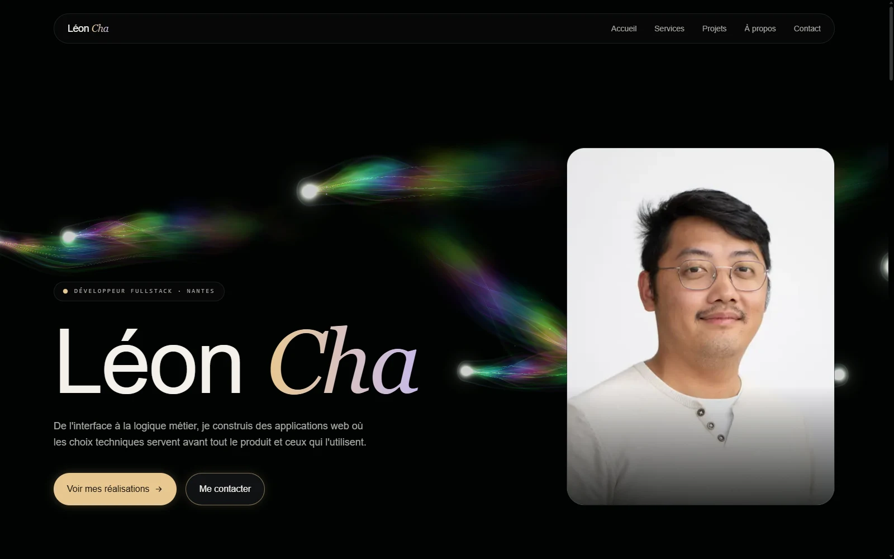
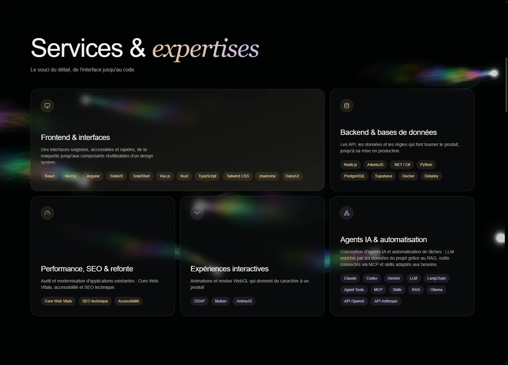
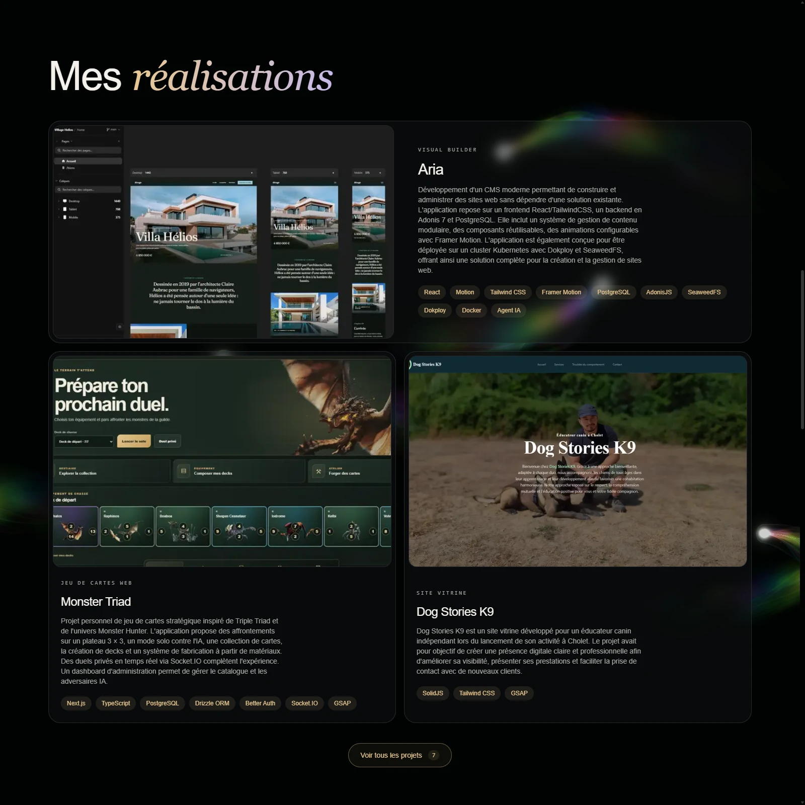
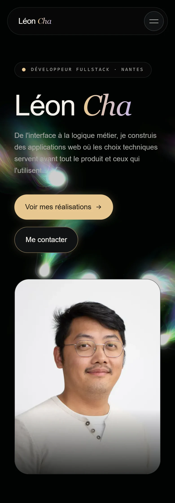

# Léon Cha — Portfolio

Portfolio personnel de Léon Cha, développeur Full Stack basé à Nantes. Le site présente mes expertises, mes réalisations et mon parcours dans une interface sombre, animée par un fond WebGL et un curseur personnalisé.



## Fonctionnalités

- **Services et expertises** : frontend, backend, performance, expériences interactives et agents IA.
- **Réalisations** : trois projets mis en avant, avec une galerie complète accessible dans une modale.
- **Parcours** : expériences professionnelles et formations organisées en onglets.
- **À propos et contact** : présentation, liens professionnels, contact par e-mail et CV téléchargeable.
- **Identité visuelle animée** : préchargement, transitions au défilement, Pyreflies en WebGL, curseur lumineux et éclairage du nom dans le footer.
- **Adaptation aux usages** : navigation mobile, commandes au clavier dans la modale et prise en compte de `prefers-reduced-motion`.

## Aperçus

Captures réalisées sur la version de production du portfolio. Les fichiers WebP sont conservés dans [docs/screenshots](docs/screenshots).

<details>
<summary>Services et expertises — ordinateur</summary>



</details>

<details>
<summary>Réalisations — ordinateur</summary>



</details>

<details>
<summary>Accueil — mobile</summary>



</details>

## Stack du portfolio

| Technologie             | Utilisation                                           |
| ----------------------- | ----------------------------------------------------- |
| Next.js 16 · App Router | Structure des pages, rendu et optimisation des images |
| React 19 · TypeScript   | Composants et typage                                  |
| Tailwind CSS 4          | Mise en page responsive et thème                      |
| GSAP · ScrollTrigger    | Préchargement et animations au défilement             |
| WebGL · GLSL            | Fond animé Pyreflies                                  |
| Canvas 2D               | Curseur lumineux et ses particules                    |
| pnpm 11.22.0            | Gestion des dépendances et commandes du projet        |

Le fond se suspend lorsque l'onglet est masqué ou que la galerie est ouverte. Le suivi des lumières dans le footer utilise des positions regroupées et interpolées pour limiter les lectures GPU ; le halo de souris est actualisé séparément du curseur.

## Lancer le projet

Environnement utilisé : **Node.js 24** et **pnpm 11.22.0**.

Dans PowerShell :

```powershell
git clone https://github.com/JunLeonCha/Portfolio.git
cd Portfolio
pnpm.cmd install
pnpm.cmd dev
```

Ouvrir ensuite [http://localhost:3000](http://localhost:3000).

Sur macOS ou Linux, utiliser `pnpm` à la place de `pnpm.cmd`.

### Commandes disponibles

| Commande         | Action                                         |
| ---------------- | ---------------------------------------------- |
| `pnpm run dev`   | Lancer le serveur de développement             |
| `pnpm run lint`  | Vérifier le code avec ESLint                   |
| `pnpm run build` | Générer la version de production               |
| `pnpm run start` | Servir la version de production après le build |

## Personnaliser le contenu

| Contenu                                | Fichier                                                                  |
| -------------------------------------- | ------------------------------------------------------------------------ |
| Présentation et portrait d'accueil     | [components/Hero/index.tsx](components/Hero/index.tsx)                   |
| Services, descriptions et technologies | [components/MyServices/services.tsx](components/MyServices/services.tsx) |
| Projets, images et ordre d'affichage   | [components/MyProjects/projects.ts](components/MyProjects/projects.ts)   |
| Expériences et formations              | [components/MyJourney/journey.ts](components/MyJourney/journey.ts)       |
| Texte de présentation                  | [components/About/about.tsx](components/About/about.tsx)                 |
| E-mail, réseaux et lien du CV          | [components/Contact/contact.ts](components/Contact/contact.ts)           |
| Couleurs et styles globaux             | [app/globals.css](app/globals.css)                                       |
| Métadonnées et composition globale     | [app/layout.tsx](app/layout.tsx)                                         |

Les visuels des projets se trouvent dans [public/images/projects](public/images/projects). Les trois premières entrées du tableau `PROJECTS` sont affichées sur la page ; la modale reprend la liste complète. Chaque projet peut fournir une image, un cadrage `imagePosition`, des technologies et un lien. Sans image, la carte affiche « Aperçu à venir ».

Les composants des effets visuels sont [pyreflies-background.tsx](components/pyreflies-background.tsx) et [lifestream-cursor.tsx](components/lifestream-cursor.tsx). Leur coordination se trouve dans [lib](lib).

## Contact

[LinkedIn](https://www.linkedin.com/in/leon-cha-02a039144/) · [GitHub](https://github.com/JunLeonCha) · [junleon.cha@gmail.com](mailto:junleon.cha@gmail.com)
